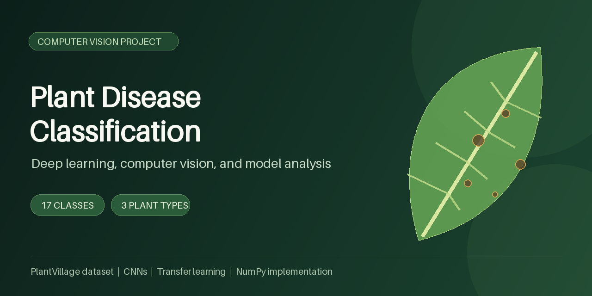

# Plant Disease Classification with Deep Learning

<p align="center">
  
  
  
  
  
</p>

<p align="center">
  <a href="https://github.com/2100031988/plant_disease_based_classification/issues/new?template=bug_report.yml">Report a bug</a> |
  <a href="https://github.com/2100031988/plant_disease_based_classification/issues/new?template=feature_request.yml">Request a feature</a> |
  <a href="https://github.com/2100031988/plant_disease_based_classification">View repository</a>
</p>

---

## Report a bug or request a feature

Choose **Report a bug** or **Request a feature** above to open the matching form. Sign in
to GitHub first; GitHub requires an account to submit an issue. Complete the form and
select **Submit new issue**.

## Project overview

This project explores image-based plant disease classification using deep learning and
computer vision. It uses the PlantVillage dataset to classify 17 disease and healthy-leaf
categories across tomato, potato, and apple plants.

The experiments compare a custom convolutional neural network (CNN), classical machine
learning models, transfer learning with ResNet18, and multimodal approaches using image,
text, and metadata. A small CNN is also implemented from scratch in NumPy and checked
against PyTorch. The project includes dataset exploration, model evaluation, statistical
comparisons, and error analysis.

> **Scope note:** PlantVillage images are collected in controlled conditions. Model scores
> on this dataset should not be treated as proof of performance on real farm or field images.



## Repository structure

```text
plant_disease_based_classification/
├── assets/
│   └── social-preview.png              # Repository preview image
├── notebooks/                          # Project workflow and experiments
│   ├── dataset_analysis.ipynb           # Download, dataset setup, and exploration
│   ├── literature_review.ipynb          # Background, research gap, and design choices
│   ├── custom_cnn.ipynb                 # Custom PyTorch CNN
│   ├── benchmark_methods.ipynb          # Classical, transfer-learning, and multimodal models
│   ├── implementation_from_scratch.ipynb # NumPy CNN, tests, and complexity
│   └── results_analysis.ipynb           # Metrics, statistics, and error analysis
├── report_materials/                   # Selected figures, tables, and report guide
├── data/                               # Created locally: images, splits, and cached features
├── models/                             # Created locally: trained model weights
├── results/                            # Created locally: figures, tables, and predictions
├── .gitignore
├── LICENSE
├── README.md
└── requirements.txt
```

`data/`, `models/`, and `results/` are generated locally and excluded from Git. The
`report_materials/` folder contains selected project figures, tables, and report-writing
notes; it does not include the dataset or model weights.

## Features

- Downloads the colour images for 17 tomato, potato, and apple categories from PlantVillage.
- Creates a stratified train/validation/test split shared across model experiments.
- Compares a custom PyTorch CNN, SVM, random forest, ResNet18, and multimodal approaches.
- Implements and tests a CNN from scratch with NumPy.
- Produces visualizations, per-class metrics, confidence intervals, statistical tests, and
  prediction error analyses.
- Records the project's literature review, design decisions, and known limitations.

## Setup

Requirements: Python 3.10 or newer, Git, and an internet connection for the initial dataset
and pretrained-weight downloads.

```bash
git clone https://github.com/2100031988/plant_disease_based_classification.git
cd plant_disease_based_classification

python3 -m venv .venv
source .venv/bin/activate
# Windows PowerShell: .venv\Scripts\Activate.ps1

python -m pip install --upgrade pip
python -m pip install -r requirements.txt
```

Open the folder in VS Code with the Jupyter extension, or start Jupyter from the repository
root:

```bash
jupyter notebook
```

Select the `.venv` Python environment as the notebook kernel.

## Run the notebooks

Run the workflow notebooks from the repository root. Use **Run All** for each notebook.

| Step | Notebook | What it does | Approximate time |
|---|---|---|---|
| 1 | `dataset_analysis.ipynb` | Downloads and explores the data; creates the shared split | 5–10 min |
| 2 | `custom_cnn.ipynb` | Trains and evaluates the custom CNN | About 2 hr 35 min |
| 3 | `benchmark_methods.ipynb` | Compares classical, transfer-learning, and multimodal methods | 30–45 min |
| 4 | `implementation_from_scratch.ipynb` | Runs the NumPy CNN and implementation checks | 5–10 min |
| 5 | `results_analysis.ipynb` | Combines predictions for the final analysis | 1–2 min |

`literature_review.ipynb` is independent and can be run at any time.

The custom CNN estimate is from a full run of 30 epochs at 256 × 256 resolution on the
original machine; your runtime will vary. For a quick smoke test, set `QUICK_TEST = True`
where that option is available. For final comparisons, set it to `False` in
`custom_cnn.ipynb`, `benchmark_methods.ipynb`, and `implementation_from_scratch.ipynb`.
Run those model notebooks on the full test split before running `results_analysis.ipynb`.
If they use different subsets, the analysis notebook warns and evaluates only the shared
prediction paths.

## Data and generated outputs

The dataset is not included in this repository. `dataset_analysis.ipynb` downloads the
colour images for tomato (10 categories), potato (3), and apple (4) from the
[PlantVillage dataset](https://github.com/digitalepidemiologylab/plantvillage_deeplearning_paper_dataset).
It stores the images under `data/plantvillage/` and writes the shared stratified split to
`data/splits.csv`. The images and trained weights are excluded from Git.

After running the notebooks, generated files are organized under:

- `results/dataset_analysis/`, `results/custom_cnn/`, `results/benchmarks/`,
  `results/implementation/`, `results/literature_review/`, and `results/analysis/` for
  figures and tables.
- `results/predictions/` for model predictions and metrics (`path`, `y_true`, `y_pred`).
- `models/` for trained custom CNN and ResNet18 weights and NumPy model artifacts.
- `report_materials/` for selected figures, CSV tables, findings, and report guidance.

## Troubleshooting

- **Python command not found on macOS:** use `python3` to create the environment.
- **`data/splits.csv` not found:** run `dataset_analysis.ipynb` first.
- **No prediction files found:** run the model notebooks before `results_analysis.ipynb`.
- **Different test subsets warning:** rerun the model notebooks with `QUICK_TEST = False`,
  then rerun the results analysis.
- **Dataset download stopped part-way:** remove `_pv_tmp/`; if needed, remove
  `data/plantvillage/` and rerun the dataset notebook.
- **Cached features are stale:** remove `data/features/` and rerun the benchmark notebook.
- **Training takes too long:** use `QUICK_TEST = True`, reduce `EPOCHS`, or lower `IMG_SIZE`
  in `custom_cnn.ipynb`. These settings are for experimentation, not final comparisons.
- **ResNet18 weights cannot be downloaded:** the first benchmark run requires internet access.
- **Notebook paths fail:** launch Jupyter from the repository root.

## Limitations

PlantVillage images have relatively uniform backgrounds, so high test scores may not
generalize to field conditions. A random split can place near-duplicate photographs in
different sets. Text and metadata are class-level rather than specific to each leaf, and
the reported experiments use a single split and random seed. Each notebook discusses
additional method-specific limitations.

## Reference

Mohanty, S. P., Hughes, D. P., & Salathé, M. (2016). Using deep learning for image-based
plant disease detection. *Frontiers in Plant Science*, 7, 1419.
https://doi.org/10.3389/fpls.2016.01419

## License

This project is distributed under the MIT License. See [LICENSE](LICENSE).
